# Architecture — Nexus

Здесь собраны схемы архитектуры Nexus по версиям.  
Формат основан на Keep a Changelog, проект придерживается Semantic Versioning.

---

## [v1.5.1] — 2026-09-11

### Схема обработки запроса

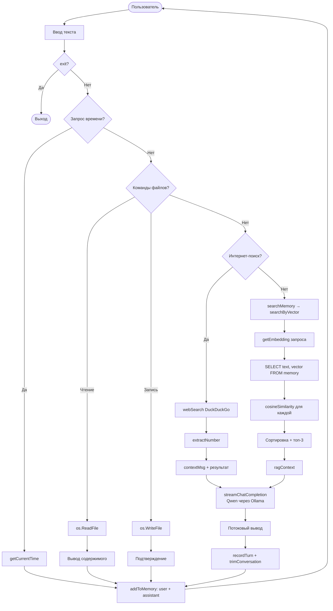

### Жизненный цикл запроса

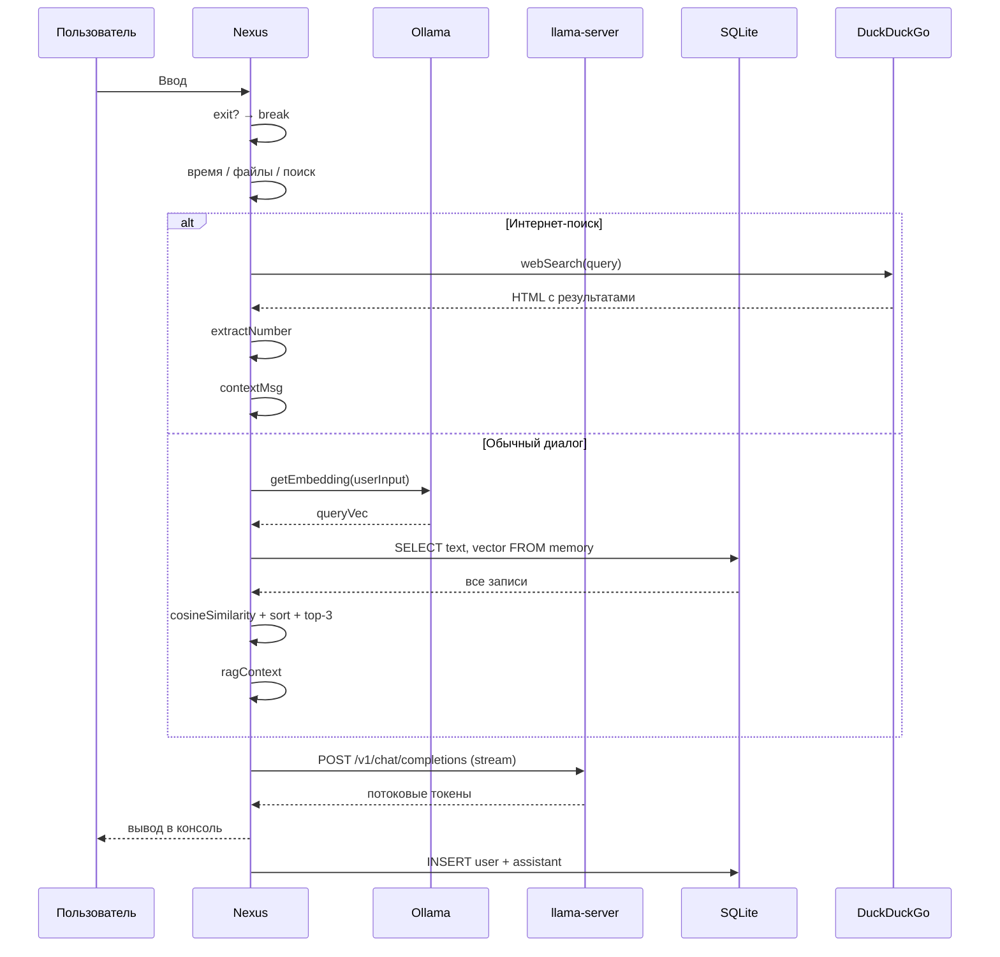

### Компоненты системы

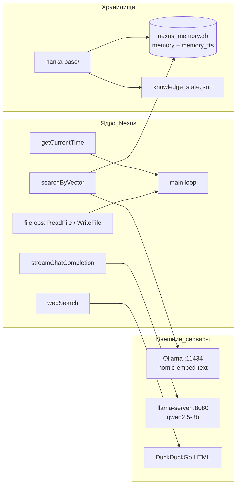

### Маршрутизация запроса

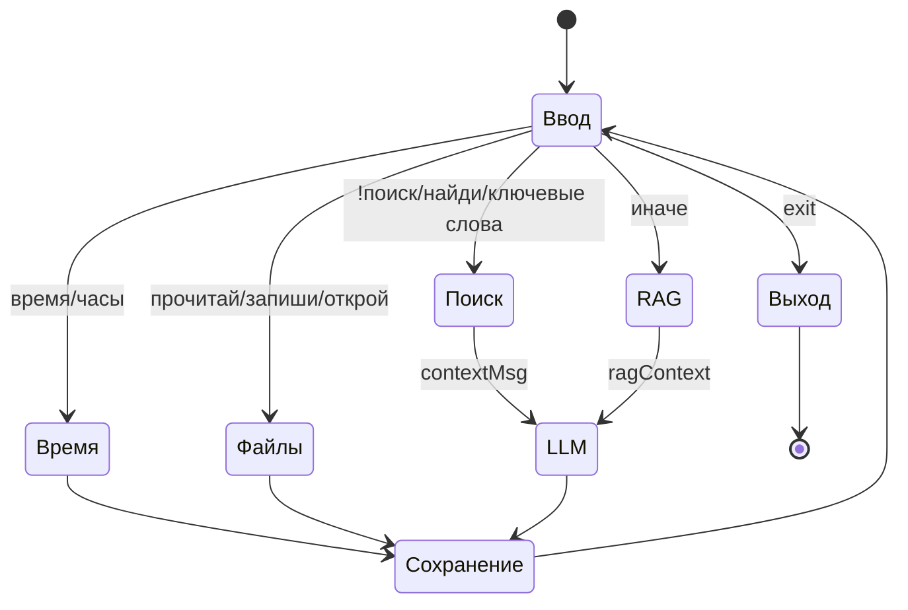

### Структура памяти (SQLite)

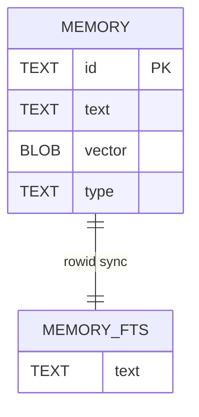

### Жизненный цикл базы знаний

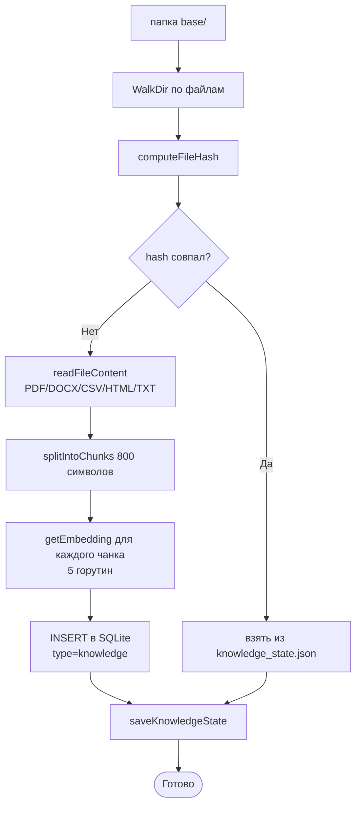

---

## [v1.5.0] — 2026-08-12

### Ключевое изменение: векторный RAG

Переход от FTS5 (поиск по словам) к косинусному сходству (поиск по смыслу).

### Схема обработки запроса

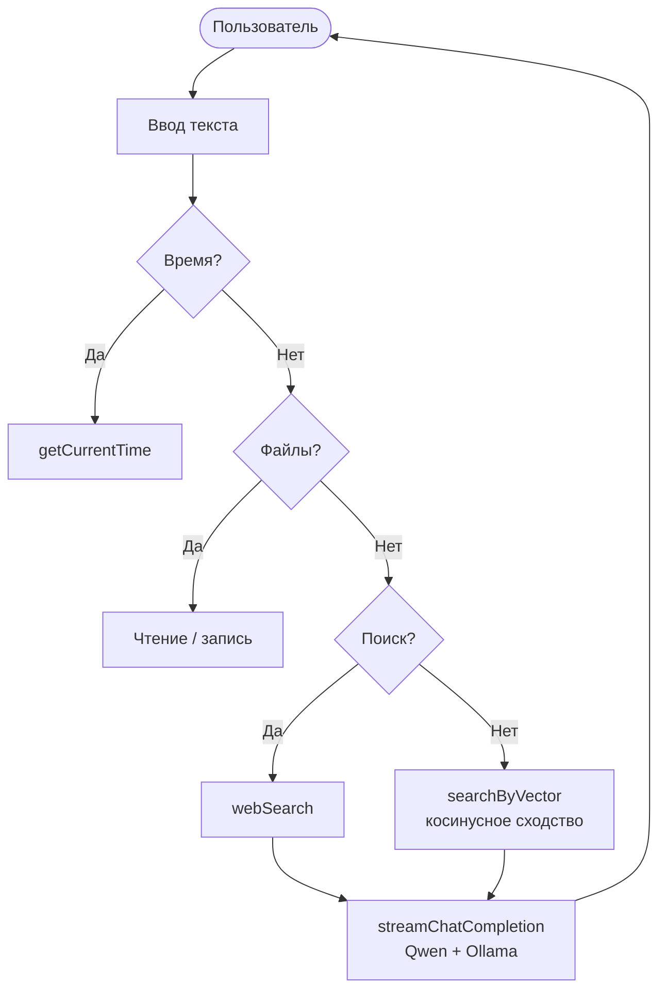

---

## [v1.4.1] — 2026-08-08

### Ключевое изменение: стабилизация

- Управление файловой системой переработано.
- Агентный цикл временно удалён.
- Системный промпт обновлён.

### Схема обработки запроса

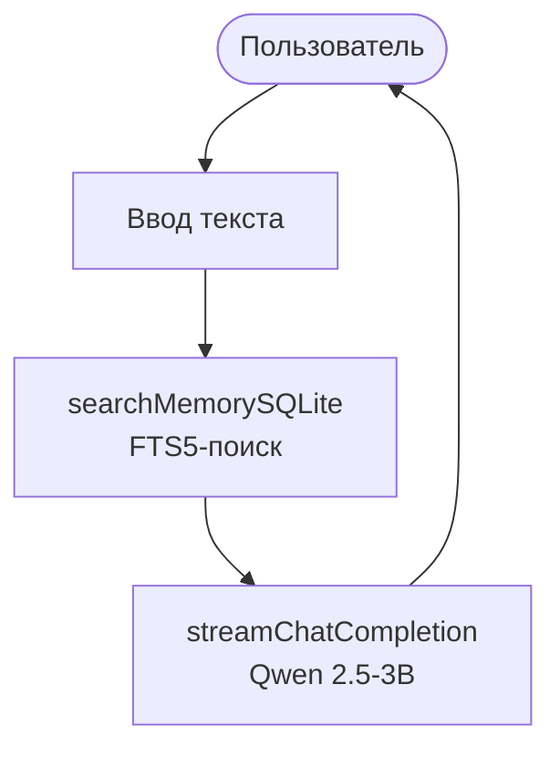

---

## [v1.4.0] — 2026-08-08

### Ключевые изменения

- Переход на Qwen2.5-3B.
- GPU-ускорение через Vulkan.
- Полноценная работа с файлами: чтение, запись, добавление, открытие.
- Команда `!последний`.

### Схема обработки запроса

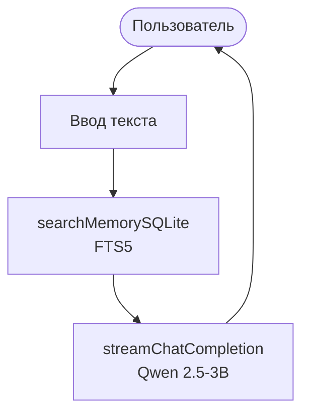

---

## [v1.3.0] — 2026-08-08

### Ключевое изменение: начало тестирования Qwen2.5-3B

### Схема обработки запроса

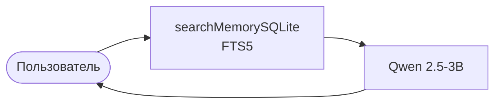

---

## [v1.2.0] — 2026-08-08

### Ключевое изменение: закрепление идентичности агента

- Улучшен системный промпт.
- Инициализирован Git-репозиторий.
- Добавлен CHANGELOG.

### Схема обработки запроса

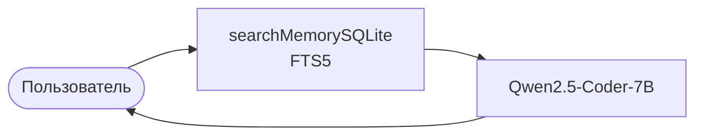

---

## [v1.1.0] — 2026-08-05

### Ключевые изменения

- **Переход с JSON на SQLite** (`nexus_memory.db`).
- Полнотекстовый поиск **FTS5**.
- Интернет-поиск через **DuckDuckGo**.
- Автоматическое определение поисковых запросов по ключевым словам.
- Команда `!поиск`.
- Извлечение чисел из результатов поиска.
- Скрипт `start.bat` для автозапуска.

### Схема обработки запроса

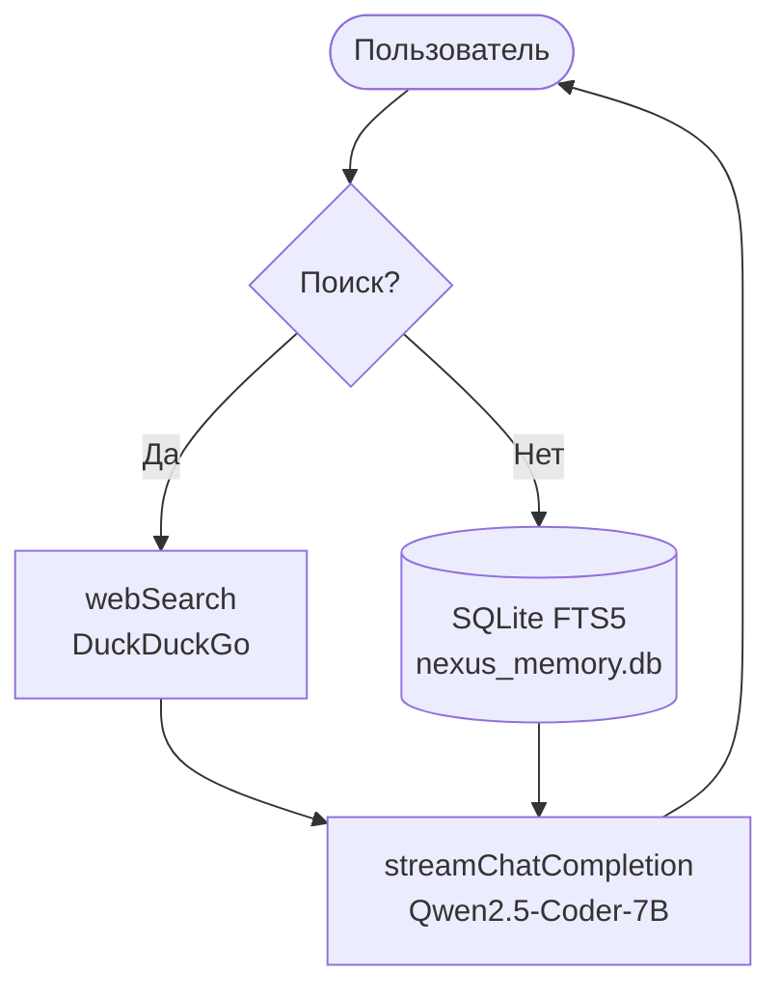

### Структура хранилища

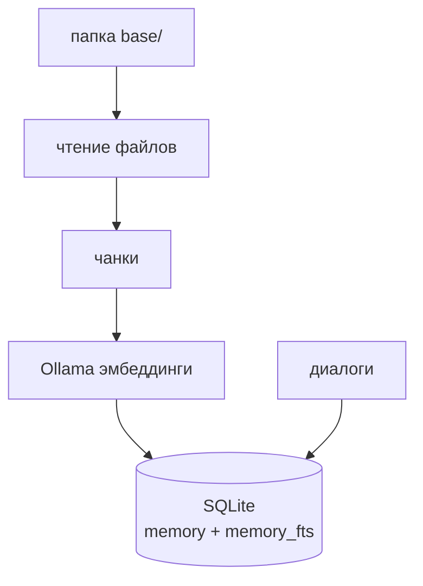

---

## [v1.0.0] — 2026-07-11

### Первая рабочая версия

- Модель: **Qwen2.5-Coder-7B-Instruct (Q5_K_M)** через llama-server.
- Память: **JSON** (`memory.json`).
- Поиск: **косинусное расстояние** между эмбеддингами.
- База знаний из папки `base`.
- Инкрементальное обновление через хеши (`knowledge_state.json`).

### Схема обработки запроса

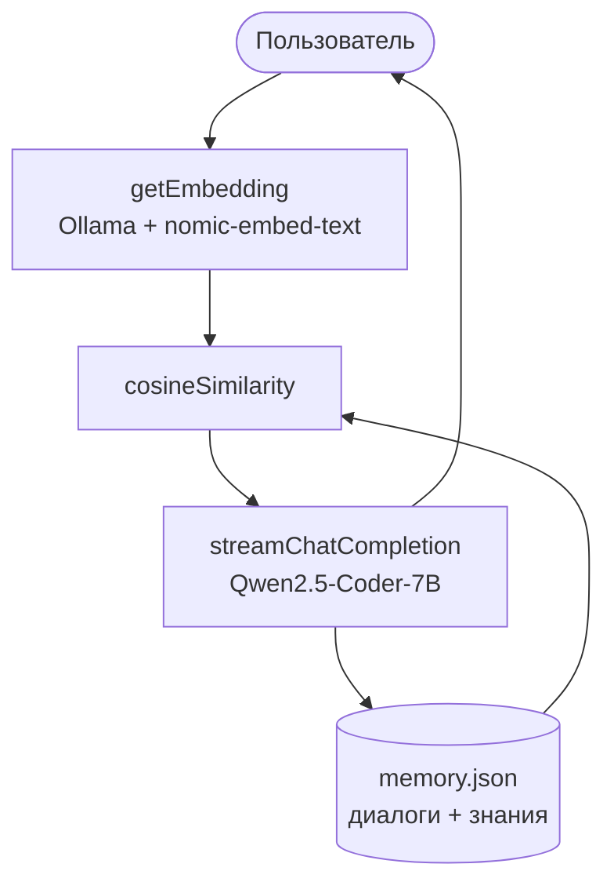

### Структура хранилища

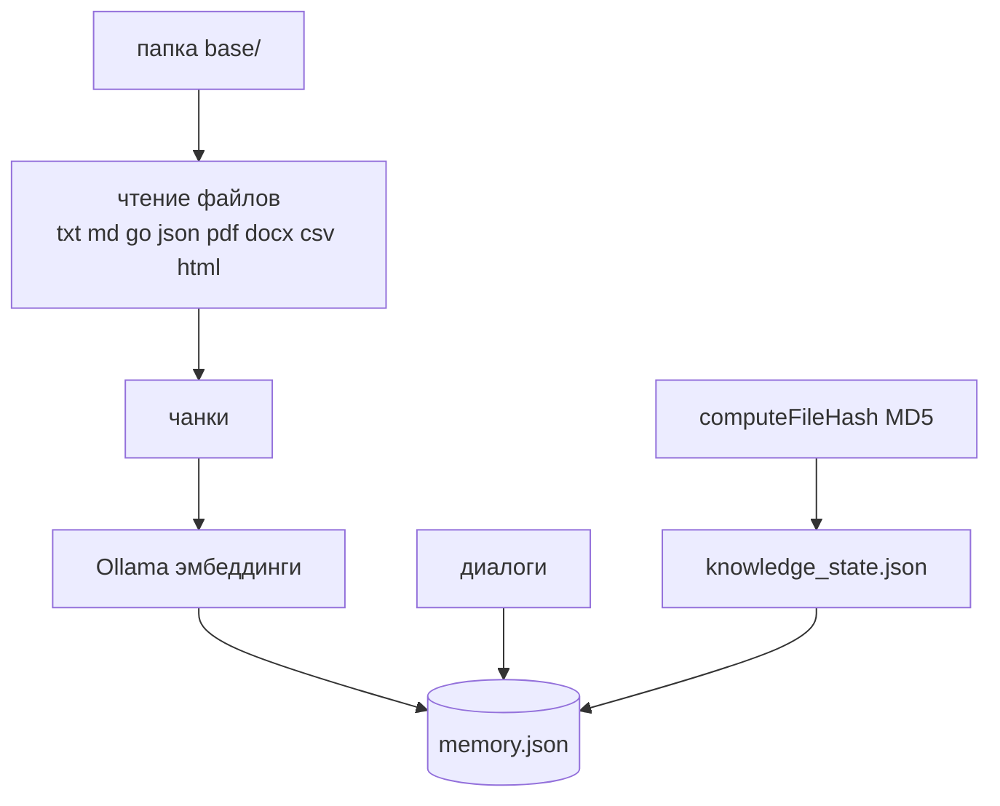