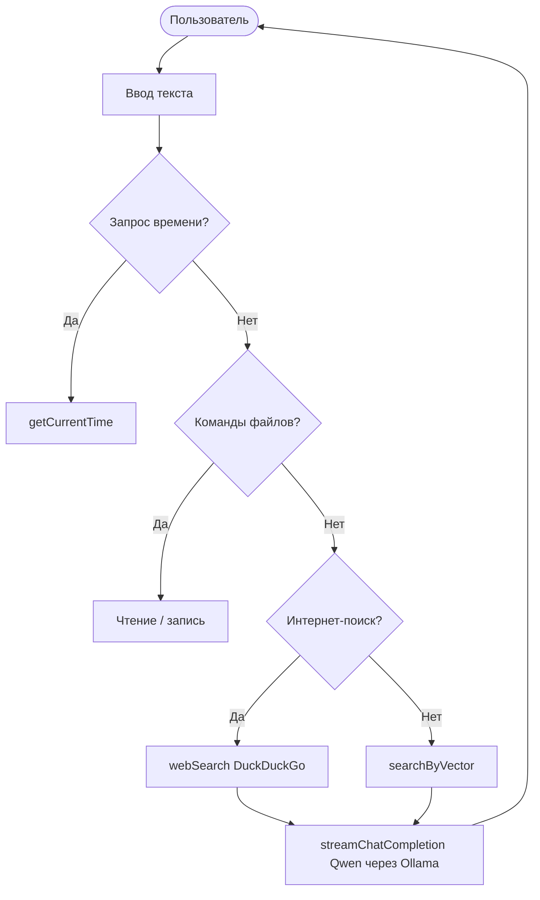

# Nexus - Local AI Agent

[](https://go.dev/)
[](LICENSE)
[](CHANGELOG.md)

Локальный AI-агент с долговременной памятью, RAG-поиском и инструментами. Работает полностью офлайн.

Local AI agent with long-term memory, RAG search, and tools. Fully offline.

---

## Русский

### О проекте

Nexus - это локальный AI-агент, разработанный для автономной работы без облачных зависимостей. Проект создан как альтернатива зарубежным AI-сервисам: все данные обрабатываются на устройстве пользователя, ничего не уходит в интернет.

Агент использует языковую модель Qwen 2.5 3B через Ollama, хранит диалоги в SQLite с векторным поиском и умеет работать с файлами, искать информацию в интернете и запоминать контекст.

### Зачем это нужно

- Приватность: данные не покидают устройство.
- Независимость: работает без интернета и облачных API.
- Автономность: сам решает, какие инструменты использовать.
- Расширяемость: легко добавлять новые функции (философия TFT).

### Возможности

- Долговременная память: все диалоги сохраняются в SQLite.
- RAG-поиск: семантический поиск по памяти через эмбеддинги и косинусное сходство.
- Интернет-поиск: актуальные данные через DuckDuckGo.
- Работа с файлами: чтение и запись 8+ форматов (PDF, DOCX, CSV, HTML, TXT, MD, JSON, GO).
- Время и дата: всегда знает текущее время.
- CI/CD: автоматические уведомления о релизах в Telegram и VK.
- Режимы работы: dev (все логи) и prod (только ответы).

### Архитектура



Подробные схемы в [ARCHITECTURE.md](ARCHITECTURE.md).

### Стек технологий

| Компонент | Технология |
|-----------|------------|
| Язык | Go 1.23+ |
| LLM | Qwen 2.5 3B (через Ollama) |
| Эмбеддинги | nomic-embed-text |
| База данных | SQLite (modernc.org/sqlite) |
| Поиск | DuckDuckGo (goquery) |
| PDF | ledongthuc/pdf |
| DOCX | nguyenthenguyen/docx |
| CI/CD | GitHub Actions |

### Быстрый старт

Требования:

- Go 1.23+ (https://go.dev/dl/)
- Ollama (https://ollama.com/)
- llama.cpp (https://github.com/ggerganov/llama.cpp)

Установка:

1. Клонировать репозиторий:

```bash
git clone https://github.com/1Maniak/nexus-client.git
cd nexus-client
```

2. Установить модели через Ollama:

```bash
ollama pull qwen2.5:3b
ollama pull nomic-embed-text
```

3. Запустить llama-server:

```bash
llama-server.exe -m models/qwen2.5-3b-instruct-q4_k_m.gguf --port 8080 -c 4096 -t 8
```

4. Собрать и запустить Nexus:

```bash
go build -o nexus.exe main.go
./nexus.exe           # dev-режим
./nexus.exe --prod    # prod-режим
```

### Структура проекта

```
nexus-client/
  main.go              точка входа
  base/                база знаний (Nexus.txt, Create.txt)
  CHANGELOG.md         история версий
  ARCHITECTURE.md      схемы архитектуры
  ROADMAP.md           план развития
  GIT_GUIDE.md         руководство по Git
  README.md            этот файл
```

### Использование

| Команда | Действие |
|---------|----------|
| Привет | Приветствие |
| Сколько времени? | Показать текущее время |
| Прочитай файл X | Показать содержимое файла |
| Открой файл X | Открыть файл в приложении |
| Запиши в файл X текст | Записать текст в файл |
| !поиск курс доллара | Поиск в интернете |
| exit | Выход |

### Roadmap

- [x] v1.0.0: первая рабочая версия
- [x] v1.5.0: векторный RAG
- [ ] v1.5.2: новая файловая система
- [ ] v2.0.0: агентный цикл (tool calling)
- [ ] NetScope: утилита диагностики сети

Подробнее в [ROADMAP.md](ROADMAP.md).

### Вклад

Проект открыт для идей и предложений. Если хочешь помочь, создай Issue или Pull Request.

### Лицензия

MIT License. См. [LICENSE](LICENSE).

### Контакты

- GitHub: https://github.com/1Maniak
- Telegram: https://t.me/Makson4ikxD
- Email: ***

---

## English

### About

Nexus is a local AI agent designed for autonomous operation without cloud dependencies. The project is an alternative to foreign AI services: all data is processed on your device, nothing goes to the internet.

The agent uses Qwen 2.5 3B via Ollama, stores dialogs in SQLite with vector search, and can work with files, search the internet, and remember context.

### Why It Matters

- Privacy: data never leaves your device.
- Independence: works without internet or cloud APIs.
- Autonomy: decides which tools to use on its own.
- Extensibility: easy to add new features (TFT philosophy).

### Features

- Long-term memory: all dialogs stored in SQLite.
- RAG search: semantic search via embeddings and cosine similarity.
- Web search: fresh data via DuckDuckGo.
- File operations: read/write 8+ formats (PDF, DOCX, CSV, HTML, TXT, MD, JSON, GO).
- Time and date: always knows current time.
- CI/CD: automatic release notifications to Telegram and VK.
- Modes: dev (all logs) and prod (responses only).

### Architecture

See [ARCHITECTURE.md](ARCHITECTURE.md) for detailed diagrams.

### Tech Stack

| Component | Technology |
|-----------|------------|
| Language | Go 1.23+ |
| LLM | Qwen 2.5 3B (via Ollama) |
| Embeddings | nomic-embed-text |
| Database | SQLite (modernc.org/sqlite) |
| Search | DuckDuckGo (goquery) |
| PDF | ledongthuc/pdf |
| DOCX | nguyenthenguyen/docx |
| CI/CD | GitHub Actions |

### Quick Start

Requirements:

- Go 1.23+ (https://go.dev/dl/)
- Ollama (https://ollama.com/)
- llama.cpp (https://github.com/ggerganov/llama.cpp)

Installation:

1. Clone the repository:

```bash
git clone https://github.com/1Maniak/nexus-client.git
cd nexus-client
```

2. Pull models via Ollama:

```bash
ollama pull qwen2.5:3b
ollama pull nomic-embed-text
```

3. Start llama-server:

```bash
llama-server.exe -m models/qwen2.5-3b-instruct-q4_k_m.gguf --port 8080 -c 4096 -t 8
```

4. Build and run Nexus:

```bash
go build -o nexus.exe main.go
./nexus.exe           # dev mode
./nexus.exe --prod    # prod mode
```

### Usage

| Command | Action |
|---------|--------|
| Hello | Greeting |
| What time is it? | Show current time |
| Read file X | Show file content |
| Open file X | Open file in default app |
| Write to file X text | Write text to file |
| !search dollar rate | Web search |
| exit | Quit |

### Roadmap

- [x] v1.0.0: first working version
- [x] v1.5.0: vector RAG
- [ ] v1.5.2: new file system
- [ ] v2.0.0: agent loop (tool calling)
- [ ] NetScope: network diagnostics tool

See [ROADMAP.md](ROADMAP.md) for details.

### Contributing

The project is open for ideas and suggestions. Create an Issue or Pull Request.

### License

MIT License. See [LICENSE](LICENSE).

### Contacts

- GitHub: https://github.com/1Maniak
- Telegram: https://t.me/Makson4ikxD
- Email: ***