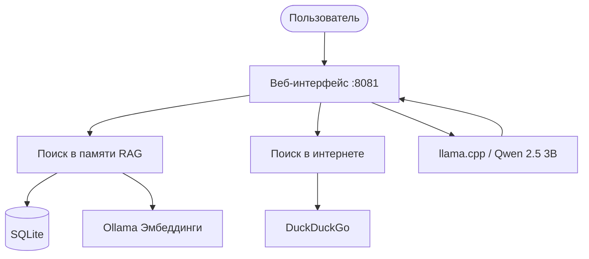

**Локальный AI-агент с долговременной памятью, RAG-поиском и веб-интерфейсом.**
**Работает полностью офлайн, без облачных зависимостей.**

---

## 📖 О проекте

**Nexus** - это локальный AI-агент, разработанный для автономной работы. Все данные обрабатываются на устройстве пользователя, ничего не уходит в интернет. Это решение для тех, кто ценит приватность и независимость от зарубежных API.

Агент использует модель **Qwen 2.5 3B** через llama.cpp, хранит диалоги в **SQLite** с векторным поиском и общается с вами через удобный **веб-интерфейс**.

### 🌟 Ключевые возможности

| Фича | Описание |
|------|----------|
| 💬 **Веб-интерфейс** | Удобный чат в браузере с темной темой и анимацией загрузки. |
| 🧠 **Долговременная память** | Все диалоги сохраняются в базе данных и не теряются. |
| 🔍 **RAG-поиск** | Семантический поиск по смыслу через эмбеддинги и косинусное сходство. |
| 🌐 **Интернет-поиск** | Получение актуальных данных через DuckDuckGo. |
| 📁 **Файлы** | Чтение и запись 8+ форматов (PDF, DOCX, CSV, HTML, TXT и др.). |
| ⚡ **Автоматизация** | Автозапуск сервисов, открытие браузера и кнопка полного выключения. |
| 🔄 **CI/CD** | Автоматические посты о релизах в Telegram и ВКонтакте. |

---

## 🛠 Стек технологий

---

## 🏗 Архитектура

---

## 🚀 Быстрый старт

### Требования
- **Go 1.23+** - [Скачать](https://go.dev/dl/)
- **Ollama** - [Скачать](https://ollama.com/)
- **llama.cpp** - [Релизы](https://github.com/ggerganov/llama.cpp/releases)

### Установка

**1. Клонируйте репозиторий:**
    git clone https://github.com/1Maniak/nexus-client.git
    cd nexus-client

**2. Скачайте модель эмбеддингов:**
    ollama pull nomic-embed-text

**3. Подготовьте llama.cpp:**
Создайте папку `llama.cpp` в корне проекта. Положите туда `llama-server.exe` и папку `models` с файлом `qwen2.5-3b-instruct-q4_k_m.gguf`.

**4. Соберите проект:**
    # Версия для разработки (с логами в консоли)
    go build -o nexus-dev.exe .

    # Релизная версия (без консоли, сразу открывает браузер)
    go build -ldflags="-H windowsgui" -o nexus.exe .

**5. Запустите:**
Запустите `nexus-dev.exe` или `nexus.exe`. Программа сама поднимет сервер и откроет браузер на `http://localhost:8081`.

---

## 🕹 Использование

| Команда | Действие |
|---------|----------|
| `Привет` | Приветствие |
| `Сколько времени?` | Показать текущее время |
| `Прочитай файл C:\test.txt` | Показать содержимое файла |
| `Запиши в файл C:\test.txt текст` | Записать текст в файл |
| `!поиск курс доллара` | Поиск в интернете |
| `exit` | Выход из консоли |

---

## 🗺 Roadmap

- [x] **v1.0.0** - Первая рабочая версия
- [x] **v1.5.0** - Векторный RAG
- [x] **v1.6.0** - Веб-интерфейс и оптимизация
- [ ] **v2.0.0** - Агентный цикл (tool calling)
- [ ] **NetScope** - Диагностика сети

Подробнее в [docs/ROADMAP.md](docs/ROADMAP.md).

---

<b>🇬🇧 Click to expand English version</b>

## About

Nexus is a local AI agent designed for autonomous operation without cloud dependencies. All data is processed on your device. The agent uses Qwen 2.5 3B via llama.cpp, stores dialogs in SQLite with vector search, and communicates through a web interface.

## Features

- **Web Interface**: local chat in the browser with a dark theme.
- **Long-term memory**: all dialogs stored in SQLite.
- **RAG search**: semantic search via embeddings and cosine similarity.
- **Web search**: fresh data via DuckDuckGo.
- **File operations**: read/write 8+ formats.
- **Automation**: full process shutdown button, auto-launch of server and browser.
- **CI/CD**: automatic release notifications to Telegram and VK.

## Quick Start

Requirements:
- Go 1.23+ (https://go.dev/dl/)
- Ollama (https://ollama.com/)
- Downloaded llama.cpp binaries (https://github.com/ggerganov/llama.cpp/releases)

1. Clone the repository:
    git clone https://github.com/1Maniak/nexus-client.git
    cd nexus-client

2. Pull embedding model via Ollama:
    ollama pull nomic-embed-text

3. Prepare llama.cpp:
Create a `llama.cpp` folder in the project root. Place `llama-server.exe` and a `models` folder with `qwen2.5-3b-instruct-q4_k_m.gguf` inside.

4. Build the project:
    # For development (console with logs)
    go build -o nexus-dev.exe .

    # For release (no console, opens browser)
    go build -ldflags="-H windowsgui" -o nexus.exe .

5. Run: Launch `nexus-dev.exe` or `nexus.exe`. The program will start services and open the browser at `http://localhost:8081`.

### License

MIT License. See [LICENSE](LICENSE).

### Contacts

- GitHub: https://github.com/1Maniak
- Telegram: https://t.me/Makson4ikxD

---

### 📄 Лицензия

Этот проект распространяется под лицензией **MIT**. Вы можете свободно использовать, изменять и распространять код, при условии сохранения оригинального уведомления об авторских правах.

