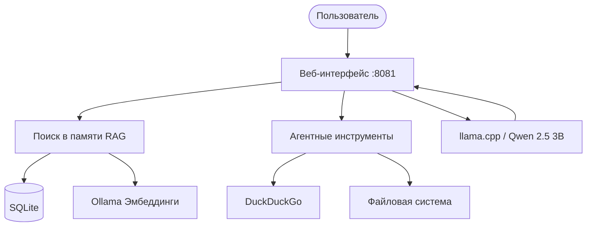

<div align="center">


[](https://go.dev/)
[](LICENSE)
[](https://github.com/1Maniak/nexus/releases/tag/v1.8.0)
[](https://1maniak.github.io/nexus/)

**Локальный AI-агент с долговременной памятью, RAG-поиском и веб-интерфейсом.**
**Работает полностью офлайн, без облачных зависимостей.**

</div>

---

## 📖 О проекте

**Nexus** - это локальный AI-агент, разработанный для автономной работы. Все данные обрабатываются на устройстве пользователя, ничего не уходит в интернет. Это решение для тех, кто ценит приватность и независимость от зарубежных API.

Агент использует модель **Qwen 2.5 3B** через llama.cpp, хранит диалоги в **SQLite** с векторным поиском и общается с вами через удобный **веб-интерфейс**. Проект насчитывает более **4300 строк** кода, написанных вручную.

### 🌟 Ключевые возможности

| Фича | Описание |
|------|----------|
| 💬 **Веб-интерфейс** | Удобный чат в браузере со стримингом ответов, темной/светлой темой. |
| 🧠 **Долговременная память** | Все диалоги сохраняются в базе данных SQLite и не теряются. |
| 🔍 **RAG-поиск** | Семантический поиск по смыслу через эмбеддинги и косинусное сходство. |
| 🌐 **Интернет-поиск** | Получение актуальных данных через DuckDuckGo. |
| 📁 **Файлы** | Открытие файлов/папок в системе, чтение 8+ форматов (PDF, DOCX, CSV, TXT и др.). |
| 🤖 **Агентность** | Модель сама решает, когда использовать инструменты (открыть файл, найти в интернете, узнать время). |
| ⚡ **Автоматизация** | Автозапуск сервисов, открытие браузера и умное выключение при закрытии вкладки. |

---

## 🌟 Почему Nexus?

Среди сотен оберток над ChatGPT и облачных ботов, Nexus выделяется архитектурой и подходом:

1. **Полная автономность и приватность**: Nexus работает на вашем железе. Вы не платите за API, ваши данные не уходят в OpenAI. Для многих разработчиков это главный аргумент.
2. **Агентность на маленькой модели**: Обычно для Tool Calling нужны модели от 7B и выше. В Nexus реализован рабочий парсер тегов для модели 3B. Это технически интересное и нестандартное решение.
3. **Бэкенд на Go**: Это не Python-скрипт на 500 строк. Это скомпилированный, быстрый сервер, который сам управляет процессами ОС, работает с SQLite и раздает фронтенд.
4. **Кастомный интерфейс**: Не дефолтный чат с Tailwind, а уникальный дизайн с матовым стеклом, стримингом и кастомными логами инструментов.
5. **Философия TFT (Tool For Tool)**: В документации заложена идея, что Nexus - это не конечный продукт, а среда для создания других инструментов. Это добавляет проекту глубины.

### ⚙️ Автоматизация из коробки

Проект полностью автоматизирован для удобной разработки и распространения:

* **CI/CD для сайта**: Любой пуш в `main` автоматически собирает и деплоит сайт на GitHub Pages.
* **Автоматические анонсы**: При создании тега `vX.Y.Z` бот вытаскивает нужную версию из `CHANGELOG.md`, создает релиз на GitHub и рассылает короткие посты в Telegram и ВК со ссылкой на сайт.
* **Сборка в один клик**: Скрипт `build.bat` сам убивает зависшие процессы и компилирует Dev/Prod версии.
* **Умное выключение (Keep-Alive)**: Сервер сам считает открытые вкладки и корректно выключается, когда закрыта последняя. При F5 не падает.
* **Фоновая загрузка**: Браузер открывается моментально, а тяжелая модель (llama-server) грузится в фоне, не блокируя интерфейс.

---

## 🛠 Стек технологий

<div align="center">


</div>

---

## 🏗 Архитектура



---

## 🚀 Установка и запуск

### 📥 Вариант 1: Для обычных пользователей (Готовый релиз)

Если вы просто хотите пользоваться Nexus, вам **не нужно** ничего компилировать. 

1. Перейдите в раздел **[Releases](https://github.com/1Maniak/nexus/releases)**.
2. Скачайте последний ZIP-архив (например, `Nexus-v1.8.0-Windows.zip`).
3. Распакуйте архив в любую папку.
4. Внутри архива следуйте подробной инструкции из файла `README.txt` (там расписано, как установить Ollama, скачать модель и запустить программу).

---

### 🛠 Вариант 2: Для разработчиков (Сборка из исходников)

Если вы хотите изменить код, добавить свои фичи или просто собрать проект самостоятельно:

**Требования:**
- **Go 1.23+** - [Скачать](https://go.dev/dl/)
- **Ollama** - [Скачать](https://ollama.com/)

**Пошаговая установка:**

**1. Клонируйте репозиторий:**
```bash
git clone https://github.com/1Maniak/nexus.git
cd nexus-client
```

**2. Скачайте модель эмбеддингов:**
```bash
ollama pull nomic-embed-text
```

**3. Подготовьте llama.cpp:**
Создайте папку `llama.cpp` в корне проекта. Положите туда `llama-server.exe` (и все DLL файлы) и папку `models` с файлом `qwen2.5-3b-instruct-q4_k_m.gguf`.

**4. Соберите проект (используя батник):**
Просто запустите скрипт `build.bat` в корневой папке проекта (двойным кликом или через терминал).
Скрипт автоматически остановит старые запущенные процессы (если они висят), соберет `nexus-dev.exe` (с логами в консоли) и `nexus.exe` (тихую релизную версию).

*Ручная сборка (если не хотите использовать батник):*
- Для отладки: `go build -o nexus-dev.exe .`
- Для релиза: `go build -ldflags="-H windowsgui" -o nexus.exe .`

**5. Запустите:**
Запустите `nexus-dev.exe` (рекомендуется для первого раза, чтобы видеть логи) или `nexus.exe`. Программа сама поднимет сервер и откроет браузер на `http://localhost:8081`.

---

## 🕹 Использование

Благодаря агентному циклу, Nexus понимает контекст и сам вызывает нужные инструменты. Вам не нужно писать сложные команды, просто общайтесь с ним как с обычным помощником.

| Пример запроса | Действие Nexus |
|---------|----------|
| `Привет` | Обычный ответ текстом. |
| `Сколько времени?` | Использует инструмент `[TOOL: time]`. |
| `Открой папку C:\Projects` | Использует `[TOOL: open]` и запускает проводник. |
| `Прочитай файл C:\test.txt` | Использует `[TOOL: read]` и выводит содержимое в чат. |
| `Найди в интернете курс доллара` | Использует `[TOOL: search]` через DuckDuckGo. |
| `exit` | Выход из консоли (в dev-режиме). |

*Примечание: Модели 3B иногда сложно даются длинные пути с кириллицей. Для лучшей работы агента рекомендуется использовать версию 7B или мощнее.*

---

## 🗺 Roadmap

- [x] **v1.0.0** - Первая рабочая версия
- [x] **v1.5.0** - Векторный RAG
- [x] **v1.6.0** - Веб-интерфейс и оптимизация
- [x] **v1.7.0** - Стриминг, Drag & Drop, Агентные инструменты
- [x] **v1.8.0** - Кастомный сайт, Boosty, автоматизация
- [ ] **v2.0.0** - Полноценный Tool Calling (JSON-схемы) и 7B модель
- [ ] **NetScope** - Диагностика сети

Подробнее в [docs/ROADMAP.md](docs/ROADMAP.md).

---

<details>
<summary><b>🇬🇧 Click to expand English version</b></summary>

## About

Nexus is a local AI agent designed for autonomous operation without cloud dependencies. All data is processed on your device. The agent uses Qwen 2.5 3B via llama.cpp, stores dialogs in SQLite with vector search, and communicates through a web interface. The project has over 4300 lines of hand-written code.

## Features

- **Web Interface**: local chat in the browser with streaming, dark/light theme.
- **Long-term memory**: all dialogs stored in SQLite.
- **RAG search**: semantic search via embeddings and cosine similarity.
- **Web search**: fresh data via DuckDuckGo.
- **File operations**: open files/folders, read/write 8+ formats.
- **Agentic loop**: model decides when to use tools (open files, search web).
- **Automation**: auto-launch of services, smart shutdown when tab is closed.

## Why Nexus?

Among hundreds of ChatGPT wrappers and cloud bots, Nexus stands out:

1. **Full autonomy and privacy**: Runs on your hardware. No API fees, no data leaks.
2. **Agentic loop on a small model**: Tool calling implemented for a 3B model.
3. **Go backend**: Compiled, fast server that manages OS processes and SQLite.
4. **Custom UI**: Unique glassmorphism design with streaming and tool logs.
5. **TFT philosophy**: Nexus is a tool for building other tools.

### Automation

- **CI/CD for website**: Push to `main` auto-deploys site to GitHub Pages.
- **Auto-announcements**: Tag `vX.Y.Z` triggers release creation and social media posts.
- **One-click build**: `build.bat` kills old processes and compiles dev/prod.
- **Smart shutdown**: Keep-Alive counts tabs and shuts down only when all closed.
- **Background loading**: Browser opens instantly, model loads in background.

## 🚀 Installation & Launch

### 📥 Option 1: For Regular Users (Ready Release)

If you just want to use Nexus, you **don't need** to compile anything.

1. Go to the **[Releases](https://github.com/1Maniak/nexus/releases)** page.
2. Download the latest ZIP archive (e.g., `Nexus-v1.8.0-Windows.zip`).
3. Extract the archive to any folder.
4. Inside the archive, follow the instructions in the `README.txt` file.

---

### 🛠 Option 2: For Developers (Build from Source)

**Requirements:**
- **Go 1.23+** - [Download](https://go.dev/dl/)
- **Ollama** - [Download](https://ollama.com/)

**Step-by-step:**

**1. Clone the repository:**
```bash
git clone https://github.com/1Maniak/nexus.git
cd nexus-client
```

**2. Pull embedding model via Ollama:**
```bash
ollama pull nomic-embed-text
```

**3. Prepare llama.cpp:**
Create a `llama.cpp` folder in the project root. Place `llama-server.exe` (and all DLL files) and a `models` folder with `qwen2.5-3b-instruct-q4_k_m.gguf` inside.

**4. Build the project (using build.bat):**
Simply run the `build.bat` script in the project root.
The script will automatically stop old running processes, compile `nexus-dev.exe` and `nexus.exe`.

*Manual build:*
- For debug: `go build -o nexus-dev.exe .`
- For release: `go build -ldflags="-H windowsgui" -o nexus.exe .`

**5. Run:**
Run `nexus-dev.exe` or `nexus.exe`. The program will start services and open the browser at `http://localhost:8081`.

## Usage

Thanks to the agentic loop, Nexus understands context and calls the necessary tools automatically.

| Example Request | Nexus Action |
|---------|----------|
| `Hello` | Standard text response. |
| `What time is it?` | Uses `[TOOL: time]`. |
| `Open folder C:\Projects` | Uses `[TOOL: open]` and launches Explorer. |
| `Read file C:\test.txt` | Uses `[TOOL: read]` and outputs content to chat. |
| `Search web for USD rate` | Uses `[TOOL: search]` via DuckDuckGo. |
| `exit` | Quits the console (in dev mode). |

## Roadmap

- [x] **v1.0.0** - First working version
- [x] **v1.5.0** - Vector RAG
- [x] **v1.6.0** - Web interface and optimization
- [x] **v1.7.0** - Streaming, Drag & Drop, Agentic tools
- [x] **v1.8.0** - Custom website, Boosty, automation
- [ ] **v2.0.0** - Full Tool Calling (JSON schemas) and 7B model
- [ ] **NetScope** - Network diagnostics

### License

Business Source License 1.1 (BSL 1.1). See [LICENSE](LICENSE) for details.

### Contacts

- GitHub: https://github.com/1Maniak
- Telegram: https://t.me/fullstack_life
- VK: https://vk.com/nexus_fullstack_life
- Boosty: https://boosty.to/1maniak

</details>

---

<div align="center">

### 📄 Лицензия

Проект распространяется под лицензией **Business Source License 1.1 (BSL 1.1)**. 

Вы можете свободно использовать Nexus в личных, учебных или внутренних коммерческих целях, изменять его и предлагать улучшения через Pull Requests. Однако использование кода для создания конкурирующего коммерческого продукта (SaaS) без разрешения автора запрещено. Через 4 года каждая версия автоматически переходит на лицензию GPLv3.

Подробнее в файле [LICENSE](LICENSE).

[](https://github.com/1Maniak)

</div>