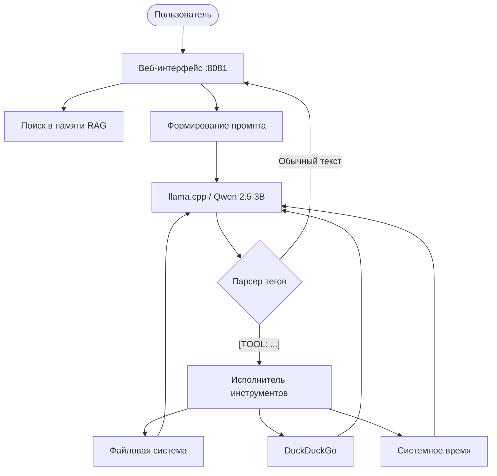
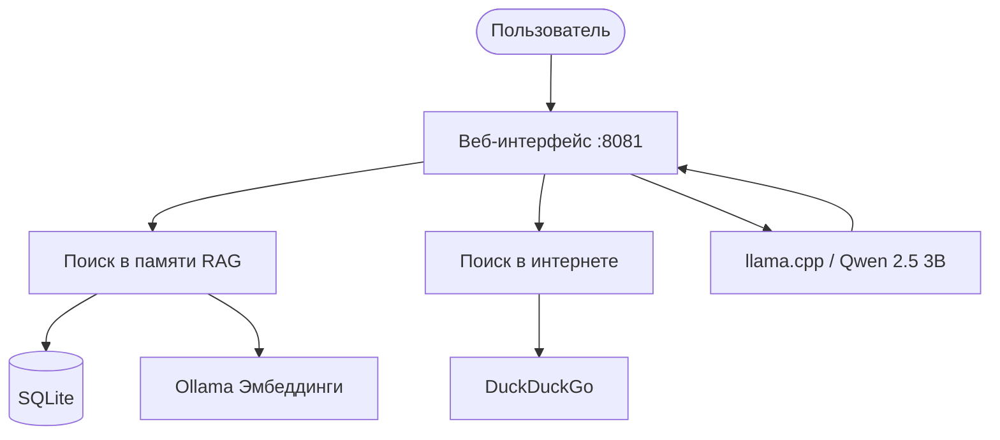
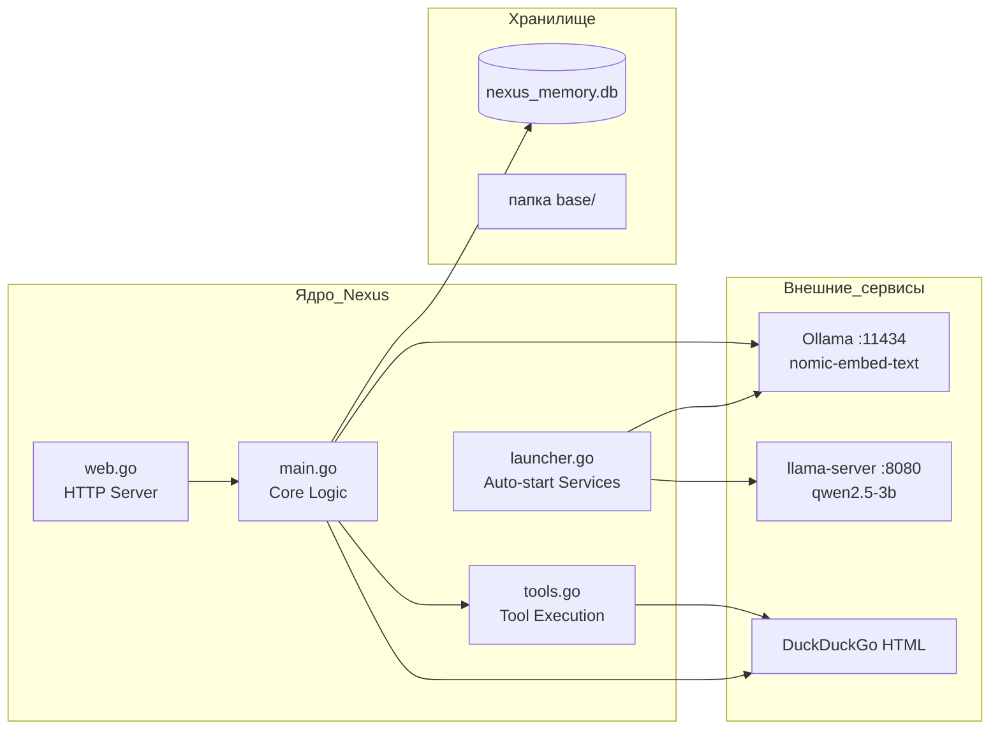
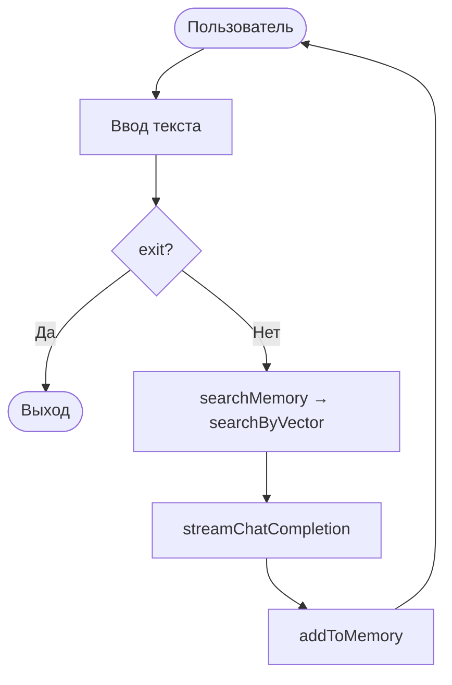

# Architecture — Nexus

Здесь собраны схемы архитектуры Nexus по версиям.  
Формат основан на Keep a Changelog, проект придерживается Semantic Versioning.

---

## [v1.8.0] — 2026-11-09

### Схема агентной обработки запроса (Tool Calling)

---

## [v1.6.0] — 2026-11-07

### Схема обработки запроса (Без агентов)

### Компоненты системы

---

## [v1.5.1] — 2026-09-11

### Схема обработки запроса (Консольная версия)

---

## [v1.0.0] — 2026-07-11

### Первая рабочая версия

- Модель: **Qwen2.5-Coder-7B-Instruct** через llama-server.
- Память: **JSON** (`memory.json`).
- Поиск: **косинусное расстояние** между эмбеддингами.