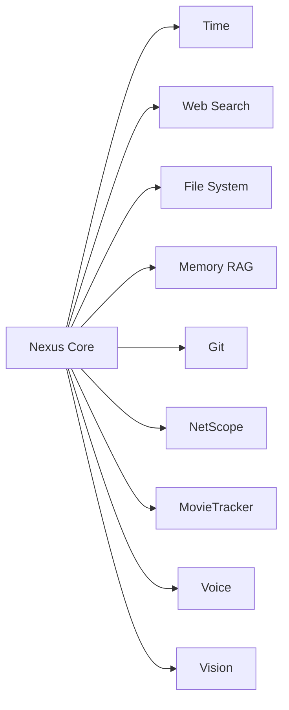

# Инструменты Nexus

Список всех инструментов и модулей экосистемы Nexus: интегрированных, находящихся в разработке и запланированных.

---

## Интегрированные

Инструменты, которые уже работают в текущей версии Nexus.

| Инструмент | Описание | Версия |
|------------|----------|--------|
| getCurrentTime | Возвращает текущее время и дату | v1.0.0 |
| webSearch | Поиск в интернете через DuckDuckGo | v1.1.0 |
| readFile | Чтение файлов (TXT, MD, GO, JSON, PDF, DOCX, CSV, HTML) | v1.0.0 |
| writeFile | Запись и перезапись файлов | v1.0.0 |
| searchMemory | Векторный поиск по памяти (RAG) | v1.5.0 |
| addToMemory | Сохранение диалогов и знаний в SQLite | v1.0.0 |
| getEmbedding | Получение эмбеддингов через Ollama | v1.0.0 |
| streamChatCompletion | Генерация ответов через LLM (Qwen) | v1.0.0 |
| loadKnowledgeFromFolder | Загрузка базы знаний из папки base/ | v1.0.0 |
| extractNumber | Извлечение чисел из результатов поиска | v1.1.0 |

---

## В разработке

Инструменты, которые находятся в процессе реализации или ближайших планах.

| Инструмент | Описание | Статус |
|------------|----------|--------|
| Токен-логгер | Замер скорости генерации токенов | Готово (v1.5.2) |
| Новая файловая система | Разделение "прочитай" и "открой", открытие папок | В работе |
| Разделение на модули | Рефакторинг монолита на отдельные файлы | Планируется (v1.5.3) |
| Агентный цикл | Tool calling: Nexus сам решает, что делать | Планируется (v2.0.0) |
| Git-интеграция | Коммиты, теги, пуш через Nexus | Планируется |

---

## Планируемые

Инструменты и модули, которые появятся в будущем.

### Модули экосистемы

| Модуль | Описание | Приоритет |
|--------|----------|-----------|
| NetScope | Диагностика сети простым языком (ПК + телефон) | Высокий |
| MovieTracker | Трекер фильмов с интеграцией в Nexus | Средний |
| Управление ПК | Открытие приложений, клики, работа с окнами | Средний |
| Голосовой интерфейс | STT (Whisper) + TTS (Piper/Silero) | Средний |
| Зрение | Анализ скриншотов, распознавание изображений | Низкий |
| Самообучение | Улучшение через RAG и дообучение (LoRA) | Низкий |
| Мобильная версия | Портирование на Android/iOS (Flutter) | Низкий |

### Дополнительные инструменты

| Инструмент | Описание | Приоритет |
|------------|----------|-----------|
| list_files | Список файлов в папке | Высокий |
| run_command | Выполнение shell-команд (go build, git) | Высокий |
| generate_file | Генерация файлов по шаблону | Средний |
| update_changelog | Автообновление CHANGELOG при теге | Средний |
| calendar | Работа с календарём и напоминаниями | Низкий |
| email | Отправка и чтение почты | Низкий |
| smart_home | Управление умным домом (Home Assistant) | Низкий |

---

## Архитектура интеграции

Все инструменты работают по единому принципу: Nexus вызывает функцию, получает результат, использует его в ответе.

---

## Как добавить новый инструмент

1. Создать функцию в отдельном файле (например, `tools_git.go`).
2. Описать инструмент в системном промпте Nexus.
3. Добавить вызов в агентный цикл (после v2.0.0).
4. Обновить этот файл.

---

## Легенда приоритетов

- **Высокий**: нужно для базовой работы, делаем в ближайшее время.
- **Средний**: важно для развития, делаем после основных.
- **Низкий**: интересно, но не критично, делаем когда будет время.

---

*Последнее обновление: 26.09.2026*