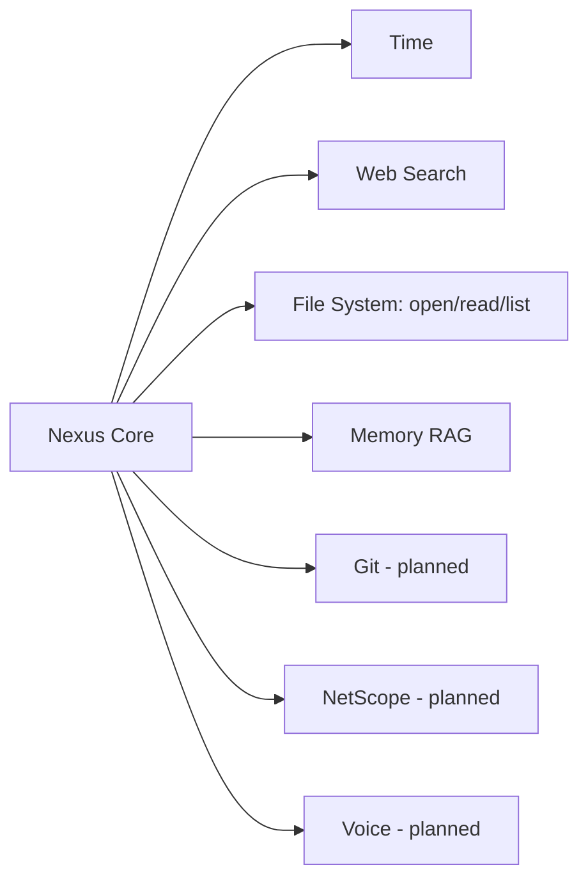

# Инструменты Nexus

Список всех инструментов и модулей экосистемы Nexus: интегрированных, находящихся в разработке и запланированных.

---

## Интегрированные (Работают сейчас)

| Инструмент | Описание | Версия |
|------------|----------|--------|
| **Web Server** | Локальный чат в браузере (HTML/JS) со стримингом | v1.8.0 |
| **Launcher** | Автозапуск Ollama и llama-server в фоне | v1.8.0 |
| **Keep-Alive Manager** | Умное выключение сервера при закрытии всех вкладок | v1.8.0 |
| **Build Script** | `build.bat` для быстрой сборки и очистки процессов | v1.8.0 |
| **Auto-Browser** | Автоматическое открытие браузера | v1.6.0 |
| **Tool Engine (Tags)** | Парсер и исполнитель команд `[TOOL: ...]` | v1.8.0 |
| getCurrentTime | Возвращает текущее время и дату (`[TOOL: time]`) | v1.8.0 |
| webSearch | Поиск в интернете через DuckDuckGo (`[TOOL: search]`) | v1.8.0 |
| readFile / openFile | Чтение и открытие файлов/папок (`[TOOL: read/open]`) | v1.8.0 |
| searchMemory | Векторный поиск по памяти (RAG) | v1.5.0 |
| addToMemory | Сохранение диалогов и знаний в SQLite | v1.0.0 |
| getEmbedding | Получение эмбеддингов через Ollama | v1.0.0 |
| streamChatCompletion | Генерация ответов через LLM (Qwen) | v1.0.0 |

---

## В разработке (Ближайшие планы)

| Инструмент | Описание | Статус |
|------------|----------|--------|
| **JSON Function Calling** | Переход на нативные JSON-схемы для надежности | Планируется (v2.0.0) |
| **Git-интеграция** | Коммиты, теги, пуш через Nexus | Планируется |
| **Генерация файлов** | Создание и запись файлов по шаблону | Планируется |

---

## Планируемые (Будущее)

### Модули экосистемы

| Модуль | Описание | Приоритет |
|--------|----------|-----------|
| NetScope | Диагностика сети простым языком (ПК + телефон) | Высокий |
| MovieTracker | Трекер фильмов с интеграцией в Nexus | Средний |
| Управление ПК | Открытие приложений, клики, работа с окнами | Средний |
| Голосовой интерфейс | STT (Whisper) + TTS (Piper/Silero) | Средний |
| Зрение | Анализ скриншотов, распознавание изображений | Низкий |
| Мобильная версия | Портирование на Android/iOS (Flutter) | Низкий |

---

## Архитектура интеграции

Все инструменты работают по единому принципу: LLM генерирует тег, Go-код перехватывает его, выполняет действие и возвращает результат обратно в LLM.

